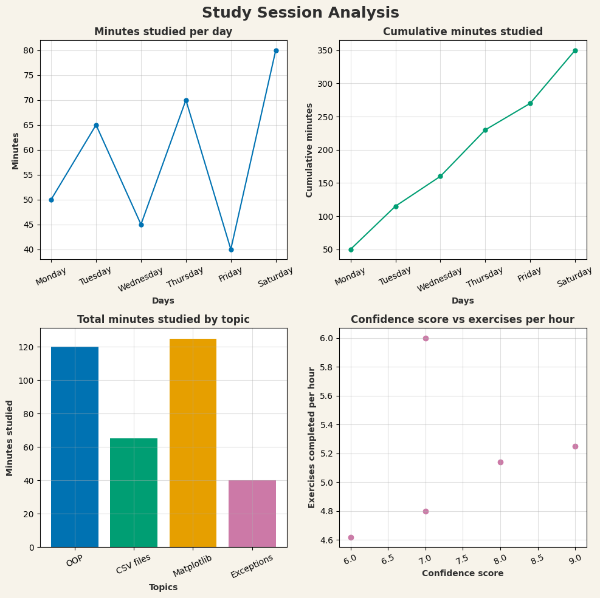

# Study Session Progress Tracker

A Python notebook that analyses six study sessions and checks progress towards a 300-minute study goal. I built it as an Advanced Python practice project to work with CSV files, classes, loops and Matplotlib.

**[View the notebook](study_session_progress_tracker.ipynb)**

## What the notebook does

- Reads study records from a CSV file with Python’s `csv.DictReader`, which lets me refer to columns by name.
- Uses a `StudySession` class to represent each session and calculate exercises completed per hour.
- Adds up study time by topic and tracks progress towards the goal.
- Includes all six sessions in the study totals and uses the five with a recorded confidence score for the confidence chart.
- Saves a four-chart figure and a plain-text report.

## What I found

I logged 350 minutes across six study sessions, 50 minutes over my goal. Matplotlib took up the most time at 125 minutes, with object-oriented programming only five minutes behind.

## Run it in Google Colab

1. Download [the notebook](study_session_progress_tracker.ipynb) and upload it to [Google Colab](https://colab.research.google.com/).
2. Run the cells from top to bottom. The first cell creates `study_sessions.csv` from data included in the notebook.
3. The analysis displays the charts and report and saves them as `study_session_analysis.png` and `study_session_report.txt` in the Colab session.
